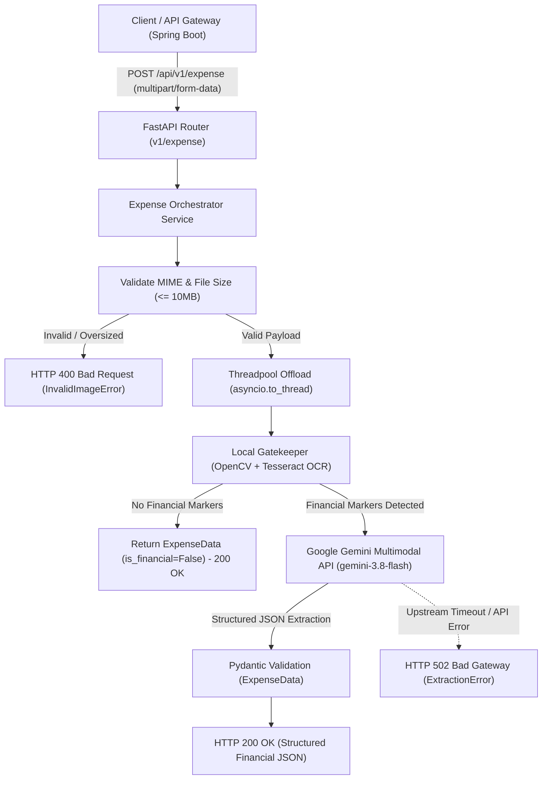

# 🧾 Expense Vision Service

[](https://www.python.org/)
[](https://fastapi.tiangolo.com/)
[](https://github.com/astral-sh/uv)
[](https://github.com/astral-sh/ruff)
[](https://docs.pytest.org/)
[](https://coverage.readthedocs.io/)
[](LICENSE)

An asynchronous AI microservice engineered with **Python 3.12+** and **FastAPI** for the **Expense Vision AI** ecosystem. It serves as an intelligent worker and gatekeeper responsible for validating, pre-processing, and extracting structured financial metadata from uploaded receipts and UPI payment screenshots.

---

## 📑 Table of Contents

- [✨ Key Capabilities](#-key-capabilities)
- [🏛️ System Architecture](#️-system-architecture)
- [🥗 Tech Stack & Ingredients](#-tech-stack--ingredients)
- [📋 Prerequisites & System Binaries](#-prerequisites--system-binaries)
- [⚙️ Configuration & Environment Variables](#️-configuration--environment-variables)
- [🚀 Quickstart & Execution](#-quickstart--execution)
- [📡 API Reference & Contracts](#-api-reference--contracts)
  - [1. Process Expense (`POST /api/v1/expense`)](#1-process-expense-post-apiv1expense)
  - [2. Health Actuator (`GET /actuators/health`)](#2-health-actuator-get-actuatorshealth)
  - [3. Interactive Documentation](#3-interactive-documentation)
- [🧪 Testing & Quality Assurance](#-testing--quality-assurance)
- [📂 Project Directory Structure](#-project-directory-structure)
- [🛡️ Security & Performance Highlights](#️-security--performance-highlights)
- [🔄 Developer Workflow Checklist](#-developer-workflow-checklist)

---

## ✨ Key Capabilities

- **⚡ Smart Gatekeeper Pre-filtering:** Local, sub-second OCR validation via **OpenCV** and **Tesseract OCR** instantly detects financial markers (e.g., `₹`, `rs`, `inr`, `upi`, `total`, `amount`, `paid`, `sent`, `transaction`). Non-financial images are rejected upfront, avoiding unnecessary LLM token consumption and latency.
- **🤖 Multimodal AI Extraction:** Leverages the **Google GenAI SDK** (`gemini-3.8-flash`) to parse complex receipts, physical invoices, and UPI screenshots into structured data.
- **🔒 Deterministic Schema Enforcement:** Strict typed schema contracts powered by **Pydantic v2** guarantee JSON responses (merchant name, total amount, ISO date, payment method, and UTR reference).
- **🚀 Non-Blocking Concurrency:** Heavy CPU-bound image decoding, OCR subprocesses, and AI inference run asynchronously in worker threadpools, ensuring the ASGI event loop remains completely responsive under high concurrency.
- **🛡️ Built-in Denial-of-Service Protection:** Enforces configurable file size thresholds and MIME type validation (`image/png`, `image/jpeg`, `image/jpg`, `image/webp`) before reading or decoding payloads.
- **📊 100% Test Coverage:** Comprehensive test suite with parameterized unit tests, mock isolation, and end-to-end integration tests.

---

## 🏛️ System Architecture

The following diagram illustrates how an uploaded image flows through the **Expense Vision Service**:



---

## 🥗 Tech Stack & Ingredients

| Layer | Technology | Version | Purpose |
| :--- | :--- | :--- | :--- |
| **Language** | [Python](https://www.python.org/) | `3.12+` | Core application runtime |
| **Framework** | [FastAPI](https://fastapi.tiangolo.com/) | `>= 0.163.1` | High-performance asynchronous web API framework |
| **ASGI Server** | [Uvicorn](https://www.uvicorn.org/) | `>= 0.54.0` | Production-grade ASGI server with auto-reload |
| **AI / Multimodal** | [Google GenAI SDK](https://github.com/googleapis/python-genai) | `>= 3.3.0` | Official SDK for Google Gemini models |
| **Computer Vision** | [OpenCV (Headless)](https://opencv.org/) | `>= 5.0.0.93` | Fast image decoding and grayscale conversion |
| **OCR Engine** | [Tesseract / pytesseract](https://github.com/tesseract-ocr/tesseract) | `>= 0.3.13` | Local optical character recognition for Gatekeeper filter |
| **Data Validation** | [Pydantic v2](https://docs.pydantic.dev/) | `>= 2.14.3` | Request/response data models and JSON validation |
| **Settings** | [Pydantic Settings](https://docs.pydantic.dev/latest/concepts/pydantic_settings/) | `>= 2.16.3` | Type-safe environment variable parsing |
| **Package Manager** | [Astral uv](https://github.com/astral-sh/uv) | Latest | Blazing-fast dependency resolver and virtual environment manager |
| **Linter / Formatter** | [Astral Ruff](https://github.com/astral-sh/ruff) | `>= 0.17.5` | Code formatting and static code analysis |
| **Testing** | [Pytest](https://docs.pytest.org/) & [pytest-cov](https://pytest-cov.readthedocs.io/) | `>= 9.2.0` | Unit & integration testing with 100% coverage |

---

## 📋 Prerequisites & System Binaries

### 1. Install `uv` Package Manager

`uv` is recommended for managing Python dependencies and virtual environments:

```bash
# Linux / macOS
curl -LsSf https://astral.sh/uv/install.sh | sh

# Windows (PowerShell)
powershell -ExecutionPolicy ByPass -c "irm https://astral.sh/uv/install.ps1 | iex"
```

### 2. Install Tesseract OCR Engine

The local Gatekeeper service requires the Tesseract OCR binary to be installed on the host machine:

- **Ubuntu / Debian:**
  ```bash
  sudo apt-get update && sudo apt-get install -y tesseract-ocr
  ```
- **macOS (Homebrew):**
  ```bash
  brew install tesseract
  ```
- **Windows:**
  Download and run the installer from [UB-Mannheim Tesseract OCR](https://github.com/UB-Mannheim/tesseract/wiki). Ensure the installation path (e.g. `C:\Program Files\Tesseract-OCR`) is added to your system `PATH`.
  Verify by running:
  ```bash
  tesseract --version
  ```

### 3. Google Gemini API Key

Obtain an API key from [Google AI Studio](https://aistudio.google.com/) for multimodal processing.

---

## ⚙️ Configuration & Environment Variables

Create your local `.env` configuration file from the template:

```bash
cp .env.example .env
```

### Environment Variables Reference

| Variable | Required | Default | Description |
| :--- | :---: | :---: | :--- |
| `GEMINI_API_KEY` | **Yes** | — | API key for Google Gemini multimodal processing |
| `GEMINI_MODEL` | No | `gemini-3.8-flash` | Gemini model identifier used for extraction |
| `HOST` | No | `0.0.0.0` | Host address to bind the Uvicorn server |
| `PORT` | No | `8000` | Port number to bind the server |
| `RELOAD` | No | `true` | Enable/disable auto-reload during development |
| `MAX_FILE_SIZE_MB` | No | `10` | Maximum allowed image upload size in megabytes |

---

## 🚀 Quickstart & Execution

### 1. Environment Setup

```bash
# Sync and install all dependencies into the managed virtual environment (.venv)
uv sync

# (Optional) Activate the virtual environment
source .venv/bin/activate       # Linux/macOS
# .venv\Scripts\activate       # Windows PowerShell
```

### 2. Running the Application

#### Option A: Recommended Development Server (via Uvicorn)
```bash
uv run python -m uvicorn main:app --app-dir src --host 127.0.0.1 --port 8000 --reload
```

#### Option B: Via Application Entrypoint
```bash
PYTHONPATH=src uv run python -m src.main
```

#### Service URLs
- **Interactive Swagger UI:** [http://127.0.0.1:8000/docs](http://127.0.0.1:8000/docs)
- **Alternative ReDoc:** [http://127.0.0.1:8000/redoc](http://127.0.0.1:8000/redoc)
- **Health Check Actuator:** [http://127.0.0.1:8000/actuators/health](http://127.0.0.1:8000/actuators/health)

---

## 📡 API Reference & Contracts

### 1. Process Expense (`POST /api/v1/expense`)

Receives an image of a physical receipt or digital payment screenshot, validates its authenticity via OCR, and extracts structured financial fields.

- **Content-Type:** `multipart/form-data`
- **Supported File Types:** `image/png`, `image/jpeg`, `image/jpg`, `image/webp`
- **Max File Size:** `10 MB` (configurable via `MAX_FILE_SIZE_MB`)

#### Sample Request (`curl`):
```bash
curl -X POST "http://127.0.0.1:8000/api/v1/expense" \
  -H "accept: application/json" \
  -F "image=@receipt.png;type=image/png"
```

#### Response Scenarios:

##### Case 1: Valid Financial Receipt (200 OK)
Returned when financial keywords are found and Gemini successfully extracts the expense details:
```json
{
  "is_financial": true,
  "merchant_name": "Coffee House",
  "amount": 245.5,
  "date": "2026-11-18",
  "payment_method": "UPI",
  "utr_number": "123456789012"
}
```

##### Case 2: Non-Financial Image Rejected by Gatekeeper (200 OK)
Returned when the image contains no financial keywords (e.g., photo of scenery, document text without financial markers). Gemini inference is bypassed entirely:
```json
{
  "is_financial": false,
  "merchant_name": null,
  "amount": null,
  "date": null,
  "payment_method": null,
  "utr_number": null
}
```

##### Case 3: Unsupported Content-Type (400 Bad Request)
```json
{
  "error": "InvalidImageError",
  "message": "Unsupported content type application/pdf",
  "path": "/api/v1/expense"
}
```

##### Case 4: File Size Exceeded (400 Bad Request)
```json
{
  "error": "InvalidImageError",
  "message": "File size exceeds maximum limit of 10 MB.",
  "path": "/api/v1/expense"
}
```

##### Case 5: AI Extraction Failure (502 Bad Gateway)
```json
{
  "error": "ExtractionError",
  "message": "Unable to extract expense data",
  "path": "/api/v1/expense"
}
```

---

### 2. Health Actuator (`GET /actuators/health`)

Readiness and liveness probe endpoint designed for container orchestrators (Kubernetes, AWS ECS, Docker Compose).

#### Request:
```bash
curl -i http://127.0.0.1:8000/actuators/health
```

#### Response (200 OK):
```json
{
  "name": "expense-vision-service",
  "status": "healthy"
}
```

---

### 3. Interactive Documentation

FastAPI auto-generates interactive OpenAPI documentation:
- **Swagger UI:** `GET /docs`
- **ReDoc:** `GET /redoc`
- **OpenAPI Schema:** `GET /openapi.json`

---

## 🧪 Testing & Quality Assurance

The project enforces strict testing standards with **100% statement and branch coverage**.

### 1. Run Unit Tests (Fast & Isolated)
Unit tests mock all external AI and OCR dependencies for instant execution:
```bash
uv run pytest
```

### 2. Run Live Integration Tests
Live integration tests exercise the end-to-end API pipeline with real image samples:
```bash
uv run pytest --integration
```

### 3. Generate HTML Coverage Report
```bash
# View coverage in terminal or generate HTML report
uv run pytest --cov=src --cov-report=html

# View in browser
xdg-open htmlcov/index.html 2>/dev/null || open htmlcov/index.html 2>/dev/null || start htmlcov/index.html
```

---

## 📂 Project Directory Structure

```text
expense-vision-service/
├── .env.example                     # Environment variables template
├── .gitignore                       # Git ignore rules
├── pyproject.toml                   # Project metadata, dependencies, & tooling config
├── uv.lock                          # Deterministic dependency lockfile
├── README.md                        # Project documentation
├── src/
│   ├── __init__.py
│   ├── main.py                      # Application factory & server startup
│   ├── config/
│   │   ├── __init__.py
│   │   └── config.py                # Pydantic Settings & logger configuration
│   ├── exceptions/
│   │   ├── __init__.py
│   │   ├── custom_exceptions.py     # Domain exceptions (AppException, InvalidImageError)
│   │   └── handlers.py              # Global exception interceptors & JSON envelopes
│   ├── router/
│   │   ├── __init__.py
│   │   ├── routers.py               # Aggregated top-level APIRouter
│   │   ├── actuators/
│   │   │   ├── __init__.py
│   │   │   └── health.py            # Health check endpoint
│   │   └── v1/
│   │       ├── __init__.py
│   │       └── expense.py           # /api/v1/expense endpoint definition
│   ├── schemas/
│   │   ├── __init__.py
│   │   └── schemas.py               # Pydantic schemas (ExpenseData contract)
│   └── services/
│       ├── __init__.py
│       ├── expense.py               # Orchestrator service (validation, OCR, AI)
│       ├── extractor.py             # Gemini multimodal extraction client
│       └── gatekeeper.py            # Local OpenCV + Tesseract OCR keyword filter
└── tests/
    ├── __init__.py
    ├── conftest.py                  # Global pytest fixtures & CLI options
    ├── helper/
    │   ├── __init__.py
    │   ├── mock_helper.py           # Context managers for mocking Gemini/GenAI
    │   └── resource_utils.py        # Fixture readers (images, JSON)
    ├── integration/                 # End-to-end tests requiring --integration
    │   ├── router/
    │   └── services/
    ├── resources/                   # Mock image assets & JSON fixtures
    │   ├── images/
    │   └── json/
    └── unit/                        # High-speed unit tests (100% coverage)
        ├── config/
        ├── exceptions/
        ├── router/
        ├── schemas/
        └── services/
```

---

## 🛡️ Security & Performance Highlights

1. **Non-Blocking Architecture:** Synchronous, compute-heavy tasks (`cv2`, `pytesseract`, synchronous I/O) are isolated from the asyncio event loop using `asyncio.to_thread`, guaranteeing that worker threads handle CPU spikes while the ASGI server continues servicing health checks and incoming HTTP connections.
2. **Deterministic Data Contracts:** The Google GenAI extraction request explicitly binds `response_schema=ExpenseData` and `response_mime_type="application/json"`. The model is constrained to generate pure, valid JSON adhering to schema constraints without hallucinated markdown fences.
3. **Layered Validation:** Multi-tier defenses protect the microservice:
   - MIME type header checks prevent non-image payloads.
   - Upper file size bounds mitigate memory exhaustion attacks.
   - Buffer decoding with OpenCV verifies image integrity before OCR or LLM transmission.
4. **Resilient Error Propagation:** Uncaught internal errors are intercepted by global handlers and sanitized into structured JSON envelopes (`error`, `message`, `path`) without exposing internal tracebacks.

---

## 🔄 Developer Workflow Checklist

When developing or submitting code changes:

1. **Synchronize Dependencies:**
   ```bash
   uv sync
   ```
2. **Apply Code Formatting:**
   ```bash
   uv run ruff format .
   ```
3. **Execute Static Analysis & Linter:**
   ```bash
   uv run ruff check .
   ```
4. **Run Unit Tests & Verify Coverage:**
   ```bash
   uv run pytest
   ```
5. **Run Full Integration Suite:**
   ```bash
   uv run pytest --integration
   ```
